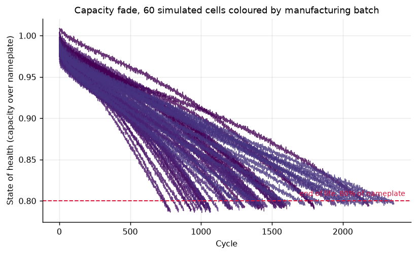
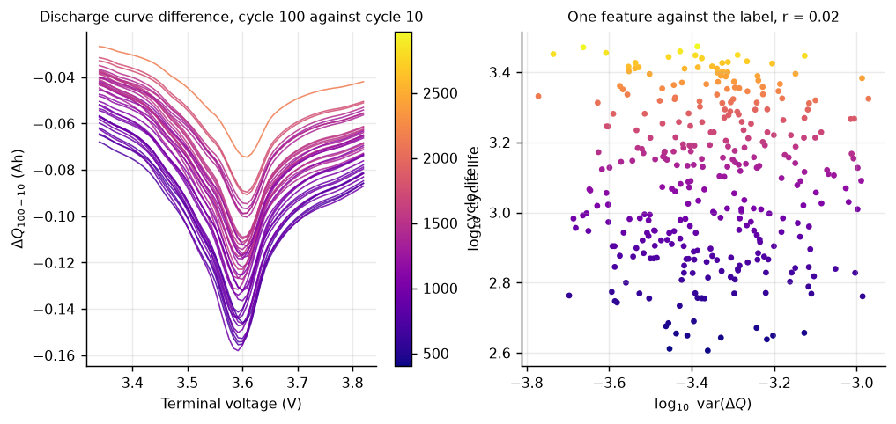
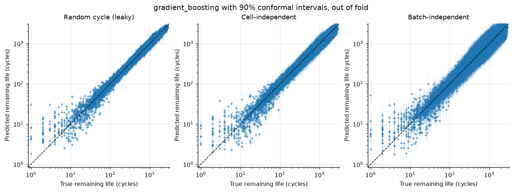
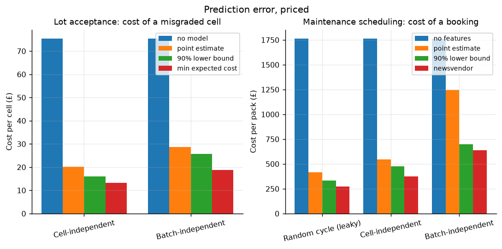

# cobalt-battery-prognostics

Predicting how long a lithium-ion pack has left, on a leakage-free evaluation
protocol, with a decision layer that turns the prediction into a booking and a
bill.

> **There is no hardware behind this.** No cycler, no thermal chamber, no cells.
> Every number on this page comes from a physics-informed simulator in
> [`src/cobalt/sim`](src/cobalt/sim), and the simulated cells are smoother and
> better behaved than real ones. What that permits and what it forbids is set
> out in [`docs/LIMITATIONS.md`](docs/LIMITATIONS.md), the model card leads with
> it, and [`src/cobalt/hal/serial_bms.py`](src/cobalt/hal/serial_bms.py) is the
> one class that would need writing if a cycler arrived.



*Sixty cells from twenty manufacturing lots, driven to 80% of nameplate. The
colour is the batch. Note that the colours cluster: cells from one coating run,
shipped to one depot, age together. That clustering is the whole argument
below.*

---

## The claim this repository is built around

**Battery prognostics results are usually reported on a split that leaks, and
the leak is worth more than the model.**

There are three ways to hold data back from a fleet of cells, and they answer
three different questions.

| Split | What it holds out | What it answers |
| --- | --- | --- |
| Random cycle | random rows | nothing useful |
| Cell-independent | whole cells | how well does this work on a new cell from a lot I know? |
| Batch-independent | whole manufacturing lots | how well does this work on the lot that arrived this morning? |

The first leaks badly. Consecutive windows from one cell overlap by all but a
few samples, so splitting them at random scores the model on rows it has all but
memorised. The second is honest about cells and still optimistic about lots: a
held-out cell has siblings in training from the same coating run, run at the
same site, on the same charge policy.

Only the third describes the situation a fleet operator is actually in. Here is
what the same model scores under all three, predicting remaining useful life
from a fifty-cycle window:

<!-- BEGIN:online -->
| Model | Random cycle (leaky) | Cell-independent | Batch-independent |
| --- | --- | --- | --- |
| Fleet mean (floor) | 677 | 675 | 666 |
| Slope extrapolation | 806 | 802 | 802 |
| Ridge | 274 | 278 | 344 |
| Gradient boosting | 77 | 116 | 178 |
<!-- END:online -->

RMSE in cycles. Read the gradient boosting row left to right: **77, then 116,
then 178.** Same model, same features, same data. The leaky protocol reports
less than half the error the honest one does.

In the units a planner cares about, the share of packs whose remaining life is
predicted within 20%:

<!-- BEGIN:online_alpha -->
| Model | Random cycle (leaky) | Cell-independent | Batch-independent |
| --- | --- | --- | --- |
| Fleet mean (floor) | 0.157 | 0.157 | 0.155 |
| Slope extrapolation | 0.317 | 0.317 | 0.317 |
| Ridge | 0.500 | 0.500 | 0.449 |
| Gradient boosting | 0.941 | 0.886 | 0.678 |
<!-- END:online_alpha -->

**94% becomes 68%.** A model you would sign off on becomes one that is wrong
about a third of the fleet.

Full protocol definitions and the leakage rules that keep these honest:
[`docs/EVALUATION_PROTOCOL.md`](docs/EVALUATION_PROTOCOL.md).

---

## Quick start

```bash
git clone https://github.com/CGainsWorks/cobalt-battery-prognostics.git
```

```bash
cd cobalt-battery-prognostics && bash scripts/setup.sh
```

Then one command reproduces every number on this page:

```bash
bash scripts/run_demo.sh
```

It simulates a 320-cell fleet, builds both feature tables, evaluates five models
under every protocol, prices the decisions, draws the figures, fits the deployed
models and rewrites the tables in this README. About four minutes on a laptop,
most of it in the simulator. No download and no GPU.

If you only want to know whether it works, this takes about two minutes on a
much smaller fleet and says on every line that its accuracy figures are a wiring
check rather than a result:

```bash
bash scripts/run_smoke.sh
```

---

## The two problems

### Early life: what is this lot worth?

A pallet of cells arrives and somebody has to grade it. Cycling one to end of
life to find out takes months of a test channel. The alternative is to cycle for
a hundred cycles and predict the rest, which is the problem Severson et al.
posed in *Nature Energy* in 2019, and the feature set here is theirs:
the variance of `dQ(V) = Q_100(V) - Q_10(V)`, the capacity fade slope, the
resistance rise, the thermal history.



*Left: `dQ(V)` for forty cells, coloured by the life they went on to have.
Right: one scalar taken from those curves against the label. The signal is there
a thousand cycles before the capacity fade curve shows anything.*

<!-- BEGIN:early_life -->
| Model | Cell-independent | Batch-independent |
| --- | --- | --- |
| Fleet mean (floor) | 678 | 691 |
| Capacity extrapolation | 665 | 658 |
| Ridge | 190 | 298 |
| Elastic net | 189 | 289 |
| Gradient boosting | 153 | 246 |
<!-- END:early_life -->

<!-- BEGIN:early_life_alpha -->
| Model | Cell-independent | Batch-independent |
| --- | --- | --- |
| Fleet mean (floor) | 0.242 | 0.259 |
| Capacity extrapolation | 0.401 | 0.400 |
| Ridge | 0.920 | 0.742 |
| Elastic net | 0.901 | 0.744 |
| Gradient boosting | 0.952 | 0.764 |
<!-- END:early_life_alpha -->

Two things in that table are worth more than the winning number.

**The engineering baseline barely beats doing nothing.** `capacity_extrapolation`
is what a competent engineer does with a spreadsheet: fit the fade over the
first hundred cycles, extend the line, read off where it crosses 80%. It scores
665 against the fleet mean's 678. Over a hundred cycles the fade is nearly flat
and nearly linear, so the extrapolation is a long lever on a small noisy slope,
and it is blind to the knee entirely. This is the reason the early-life problem
needed a paper.

**The gap between the two columns is the honest cost of a new lot.** 153 becomes
246, and 0.95 becomes 0.76. The fold-to-fold standard deviation on the
batch-independent column is large (±84 cycles for gradient boosting), which is
itself the finding: with five lots held out per fold, which five you get matters
enormously, and any single-number claim about a new lot is overconfident.

### Online: when do I book the workshop?

For the rest of the pack's life the question changes. Not "how healthy is it"
but "when do I need a replacement on the shelf". Each prediction is made from a
trailing fifty-cycle window of ordinary battery-management-system telemetry, and
nothing in the feature set requires a laboratory reference discharge, because a
pack in service does not get one.



---

## A point estimate is not a decision

"About 900 cycles" and "somewhere between 300 and 1500" carry the same number
and imply completely different amounts of spare stock. So every deployed model
here is wrapped in split conformal prediction and ships an interval.

Which raises the question conformal prediction is usually not asked: **calibrated
on what?** Calibrate on cells drawn at random from lots the model already knows,
and the residuals are smaller than they will be on a new lot, so the interval
comes out too narrow and the coverage it advertises is not the coverage it
delivers.

<!-- BEGIN:coverage -->
| Task | Protocol | Asked for | Grouped calibration | Random calibration | Difference |
| --- | --- | --- | --- | --- | --- |
| Early life | Cell-independent | 90% | 0.901 | 0.901 | +0.000 |
| Early life | Batch-independent | 90% | 0.859 | 0.735 | -0.125 |
| Online RUL | Random cycle (leaky) | 90% | 0.904 | 0.904 | +0.000 |
| Online RUL | Cell-independent | 90% | 0.918 | 0.812 | -0.107 |
| Online RUL | Batch-independent | 90% | 0.921 | 0.579 | -0.343 |
<!-- END:coverage -->

Read the bottom row. A 90% interval, calibrated the ordinary way, **covers 58%
of the time on a lot it has not seen**. Calibrated on held-out lots, the same
interval covers 92%. The first row of each pair is the control: where the
protocol splits on random rows, random calibration is the matched choice and the
two agree exactly, as they must.

An interval that is too wide is visibly cautious. One that undercovers is
invisibly wrong, and it is the one you get by default.

Grouped calibration is not free, and the repository says where it stops paying:
it removes whole groups from the fit, so below about four remaining groups the
model loses more from the missing variety than the calibration gains. That
threshold is a named constant with a test behind it, not a footnote.

---

## What the errors cost

An RMSE improvement that does not change a decision is worth nothing. Both
models here feed a specific decision with a specific asymmetric cost, and both
decisions have a right answer that is not the point estimate.



### Booking a replacement is a newsvendor problem

Book too late and the pack runs past end of life: derated range, elevated
failure risk, warranty exposure, charged here at £14.00 a cycle. Book too early
and you scrap usable life you have already paid for, at £2.40 a cycle. Write
those as a pinball loss and the minimiser is a quantile of the predictive
distribution, at

    q* = c_early / (c_early + c_late) = 2.40 / 16.40 = 0.146

Not the mean. Not the median. The **fifteenth percentile**, which says the
booking should sit well below the model's central estimate. This is the
newsvendor problem, and a fleet scheduling on the point estimate is answering a
question nobody asked.

<!-- BEGIN:replacement -->
| Scheduling policy | Random cycle (leaky) | Cell-independent | Batch-independent |
| --- | --- | --- | --- |
| Oracle (unreachable floor) | £0.00 | £0.00 | £0.00 |
| Fleet quantile (no features) | £1765.88 | £1765.88 | £1765.88 |
| Book on the point estimate | £417.83 | £546.61 | £1245.04 |
| Book on the 90% lower bound | £334.59 | £477.87 | £699.91 |
| Book on the newsvendor quantile | £270.54 | £375.44 | £636.88 |
<!-- END:replacement -->

Pounds per pack. Read the batch-independent column, which is the only one
describing reality:

- Doing nothing clever costs **£1,766** a pack.
- The model, read naively, costs **£1,245**.
- The same model, read correctly, costs **£637**. Nothing changed except which
  statistic came out of the predictive distribution.

The mechanism is visible in one diagnostic: booking on the point estimate runs
**53%** of packs past end of life. Booking on the newsvendor quantile runs
**14%** of them past, against the 14.6% the cost model asked for. The theory is
doing exactly what it said it would.

And the leaky protocol would have told you to budget **£271**. The real bill is
£637. Evaluating badly does not just overstate accuracy, it under-budgets by a
factor of two and a half.

### Grading a lot is a Bayes decision

Grade A, B or C by predicted cycle life. Undergrading a good cell loses the
margin between two price bands, tens of pounds. Overgrading a poor one puts a
cell that will not last into an application that assumed it would, and that bill
arrives as a field replacement with labour attached. The cost matrix is in
[`config/default.yaml`](config/default.yaml).

<!-- BEGIN:grading -->
| Grading rule | Cell-independent | Batch-independent |
| --- | --- | --- |
| Grade everything B (no model) | £75.48 | £75.48 |
| Model, point estimate | £20.08 | £28.65 |
| Model, 90% lower bound | £16.02 | £25.72 |
| Model, minimum expected cost | £13.30 | £18.69 |
<!-- END:grading -->

The interesting row is the third. **"Use the pessimistic end of the interval" is
the obvious heuristic and it is not the right answer.** It fixes the expensive
overgrading and then overshoots, because undergrading is not free either: at a
90% bound almost everything falls into C and the lost margin outweighs the
failures prevented. The rule the cost matrix actually implies is an expectation:
integrate the probability of each true grade over the predictive distribution
and take the assignment with the lowest expected cost. That is the fourth row,
and it beats both.

### Test time

Grading at a hundred cycles instead of cycling to end of life:

| | |
| --- | --- |
| Median cycle life | 1,281 cycles |
| Full qualification test | 85.4 channel-days |
| Early-life test | 6.7 channel-days |
| **Saved** | **92.2%** |

Cycler channels are the constrained resource in every battery laboratory, and
this part of the business case does not depend on the model being good, only on
it being usable.

---

## The fleet these numbers come from

<!-- BEGIN:fleet -->
| Fleet | Value |
| --- | --- |
| Cells simulated | 320 |
| Manufacturing batches | 20 |
| Cell-cycles simulated | 464,401 |
| Cycle life, min / median / max | 404 / 1281 / 2973 |
| Longest life over shortest | 7.36x |
| Right-censored at the ceiling | 6 |
<!-- END:fleet -->

The simulator is a lumped empirical model with the four mechanisms that dominate
the published ageing literature: square-root-of-time SEI growth with an
Arrhenius temperature term, throughput-driven lithium plating worsened by high
charge rate and by low temperature, a knee where the two interact, and
resistance rise that brings the discharge cut-off forward as the cell ages. Fade
curves, knee behaviour and Arrhenius sensitivity come out roughly the right
shape and magnitude. **No parameter in it was fitted to laboratory data, because
there was no laboratory.**

Cells are drawn in batches, and a batch shares a coating run and a deployment
site. Between-batch spread is several times within-batch spread, which is what
makes the batch-independent protocol a genuinely harder question rather than a
formality, and there is a test asserting that it stays that way.

---

## What is actually here

```
src/cobalt/
  sim/          cell degradation model and fleet generator (the stand-in for a lab)
  hal/          BmsSource interface: SimulatedBms works, SerialBms is the honest gap
  data/         on-disk schema, and the three split protocols
  features/     early-life dQ(V) features, and online window features
  models/       baselines, regressors, split conformal with grouped calibration
  evaluate/     the protocol loop, metrics, figures, and the README's tables
  business/     newsvendor scheduling and Bayes-optimal lot grading
  service/      FastAPI: ingest telemetry, get a booking, rank the fleet
  deploy.py     fit the shipped models, write the model card
  cli.py        generate / evaluate / stream / report / serve
```

### The service

```bash
make serve
```

`POST /v1/packs/{id}/cycles` takes telemetry. `GET /v1/packs/{id}/health`
returns a booking, and it leads with `book_replacement_after_cycles` rather than
with the point estimate, because that is the field the decision hangs on.
`GET /v1/fleet/risk` ranks the fleet soonest-first. `GET /v1/model` returns the
model card, whose first field says the training data was simulated.

There is one feature-extraction function, used by training and by serving alike,
and a test asserts the service and the library return the same number for the
same window. Training-serving skew is not a risk this codebase takes.

### The hardware gap, concretely

```bash
make stream
```

runs a simulated pack through the deployed model over the same interface a real
one would use, cycle by cycle. Swapping in real hardware is one class:
[`SerialBms`](src/cobalt/hal/serial_bms.py), which currently raises
`NoHardwareError` from every method that would touch a device, with a test
asserting it does rather than returning something plausible.
[`docs/HARDWARE.md`](docs/HARDWARE.md) specifies the rig, down to why three
coating lots is the minimum that makes this repository's argument testable at
all.

---

## Reproducing and checking

| Command | What it does |
| --- | --- |
| `make demo` | everything, end to end, from nothing |
| `make smoke` | the same pipeline on a small fleet, about two minutes |
| `make test` | the test suite |
| `make lint` | ruff |
| `make check` | assert the README's tables match the committed results |
| `make serve` | the fleet service |
| `docker compose up` | `make demo` in a container |

No number in this README is typed by hand. Every table between a pair of
`BEGIN`/`END` markers is rendered from
[`results/default/summary.json`](results/default/summary.json), and
`make check` regenerates them and fails if the file has drifted. Continuous
integration runs that check on every push, so a stale table is a red build
rather than a quiet lie.

The full report, with fold standard deviations and confusion matrices, is
[`analysis/default/EVALUATION.md`](analysis/default/EVALUATION.md).

---

## What I would not claim from this

The honest boundary, in full in [`docs/LIMITATIONS.md`](docs/LIMITATIONS.md).
The short version:

- **No accuracy number here transfers to a real cell.** The simulator is
  smoother than reality. One symptom is measurable in this repository: the
  elastic net leans on the capacity fade slope rather than on the `dQ(V)`
  variance that dominates the published real-cell result, because a fade slope
  measured over a hundred simulated cycles is far cleaner than a real one.
  A simulator cannot reproduce the motivation for a feature it has designed
  away.
- **The methodological results are the transferable part.** That a random split
  leaks, that grouped calibration is required for honest intervals, and that the
  cost-optimal decision is a quantile rather than a point estimate are
  properties of the evaluation and the decision theory, not of the chemistry.
- **The cost figures are illustrative.** They are configuration, sized for a
  small commercial pack. They set the shape of the answer, not its truth.
- **The conformal interval is turned into a full predictive distribution by
  assuming Gaussian residuals in log space.** That assumption is wrong in the
  tails. A conformalised quantile regressor would remove it, and is the obvious
  next piece of work.

---

## Licence

MIT. See [LICENSE](LICENSE).
